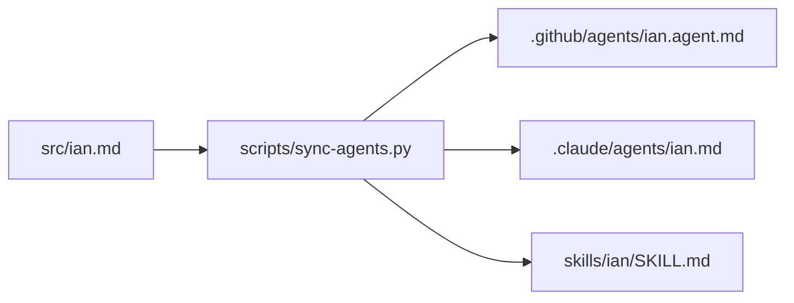

# agents

Custom AI agents I use, packaged so teammates can drop them into the tool they already work in.

The goal is to give you a quick way to learn how I work: my preferred formats (commits, PRs, docs), naming and tooling choices, and how I like to review work. Ask it a question or paste in something to review. If it does not know, it will not guess; it gives you a structured list of questions to bring to me.

> The agents are AI stand-ins built from a written summary of my preferences. They are not me and can be wrong or out of date. Confirm anything important with the real me.

## Get the agent

| Your tool                | File                                                       | How to use it                                                                                              |
| ------------------------ | ---------------------------------------------------------- | ---------------------------------------------------------------------------------------------------------- |
| VS Code / GitHub Copilot | [.github/agents/ian.agent.md](.github/agents/ian.agent.md) | Open Chat and pick **Ian** from the agent picker.                                                          |
| Claude Code              | [.claude/agents/ian.md](.claude/agents/ian.md)             | Run `claude --agent ian`, or mention it with `@"ian (agent)"`.                                             |
| Gemini (web app)         | [skills/ian/SKILL.md](skills/ian/SKILL.md)                 | In Gemini, go to **Customize**, then **Skills**, upload the `skills/ian` folder, then call it with `/ian`. |

The first two work automatically when you clone this repo.

Don't want the whole repo? Download `ian-agents.zip` from the [latest release](../../releases/latest). It contains only the agent files, in a folder named after the agent:

```text
ian/
├── ian.agent.md   VS Code / GitHub Copilot
├── ian.md         Claude Code
└── SKILL.md       Gemini
```

Copy `ian.agent.md` to `.github/agents/` and `ian.md` to `.claude/agents/` in your project, or upload `SKILL.md` to Gemini.

## Try asking

- "How would Ian want me to write the commit message for this change?"
- "Review this PR description against Ian's standards."
- "What language would Ian pick for a command line tool that only runs on macOS?"

## Contributing

These files are generated from one source, so a change lands in all three at once.



- Edit [src/ian.md](src/ian.md) (shared body). Per-target frontmatter lives in [scripts/sync-agents.py](scripts/sync-agents.py).
- Regenerate: `docker compose run --rm sync`
- Verify: `docker compose run --rm check`
- Never edit the generated files; the pre-commit hook and the [check-agents](.github/workflows/check-agents.yml) workflow fail on drift.
- A merge to `main` that changes an agent file publishes a release through the [release](.github/workflows/release.yml) workflow. Build the zip locally with `docker compose run --rm package` (output in `dist/`).
- Enable the hook once per clone: `git config core.hooksPath .githooks`
- Full rules for contributors and other agents: [AGENTS.md](AGENTS.md)
